# The TYPO3 Action API

*One typed, self-describing API for the TYPO3 backend, external
integrations and AI agents.*

> **Status:** Proposed for TYPO3 v15, currently in review.
> Epic: [#111053](https://forge.typo3.org/issues/111053).
> Details may still change; some parts are work in progress.

## Contents

1. [Why](#why)
2. [The core idea: `#[AsAction]`](#the-core-idea-asaction)
3. [From PHP method to HTTP endpoint](#from-php-method-to-http-endpoint)
4. [Replacing internal AJAX routes](#replacing-internal-ajax-routes)
5. [How an HTTP request is dispatched](#how-an-http-request-is-dispatched)
6. [External applications: EXT:hub](#external-applications-exthub)
7. [Scopes: what an app may do](#scopes-what-an-app-may-do)
8. [Nesting: MCP is just another action](#nesting-mcp-is-just-another-action)
9. [OpenAPI and Swagger UI](#openapi-and-swagger-ui)
10. [Overview of the changes](#overview-of-the-changes)

---

## Why

TYPO3 has no uniform way for remote systems to talk to it. The backend
JavaScript calls AJAX routes with hand-written controllers, integrations
need custom extensions, and AI agents have nothing at all. Every new
consumer means wrapping the same functionality again.

The Action API turns this around: a feature is written **once** as an
action. It is then available as:

* a JSON endpoint below `/typo3/api/`, used by the backend itself,
* an operation in a generated OpenAPI description,
* an endpoint for external applications, authorized via OAuth 2.0 or a
  static token (EXT:hub),
* a tool for AI clients via the Model Context Protocol (MCP).

No extra integration code is needed for any of these.

---

## The core idea: `#[AsAction]`

A public method of a service becomes an action by adding the
`#[AsAction]` attribute:

```php
use TYPO3\CMS\Core\Action\ActionContext;
use TYPO3\CMS\Core\Action\ActionType;
use TYPO3\CMS\Core\Action\Error\NotFoundError;
use TYPO3\CMS\Core\Attribute\AsAction;
use TYPO3\CMS\Core\Scope\ContentReadScope;

final readonly class PageTitleAction
{
    /**
     * @return list<string>
     * @throws NotFoundError if the page does not exist
     */
    #[AsAction(
        type: ActionType::fetch,
        name: 'my-extension/page/{uid}/titles',
        summary: 'Fetch the titles of a page and its translations',
        scopes: [ContentReadScope::class],
    )]
    public function titles(int $uid, ActionContext $context): array
    {
        // …
        throw new NotFoundError('Page not found', 1791975434);
    }
}
```

The method signature is the contract:

| Source                                         | Becomes                                         |
|------------------------------------------------|-------------------------------------------------|
| Parameter types and PHPDoc                     | JSON Schema of the input                        |
| Return type and PHPDoc (`list<string>`, shapes)| JSON Schema of the output                       |
| `@throws` (action errors)                      | Documented error responses (e.g. 404, 403)      |
| `type`                                         | HTTP method and MCP tool hints                  |
| `name` / `route`                               | Identifier and route path, `{uid}` placeholders |
| `summary`, `description`, `tag`                | Human and AI readable documentation             |
| `scopes`                                       | Required authorization                          |

Some details:

* **Action types** map to HTTP methods: `fetch` → `GET`,
  `create` → `POST`, `replace` → `PUT`, `update` → `PATCH`,
  `delete` → `DELETE`, `dispatch` → `POST`.
* **`ActionContext`** is not part of the public schema. It is passed in
  automatically and provides the TYPO3 `Context`, the authenticated user,
  a translator, the current request and the granted scopes.
* **Errors** are exceptions implementing `ActionExceptionInterface`, which
  define the HTTP status code. The core ships `NotFoundError` (404) and
  `PermissionDeniedError` (403). Every error an action may report **must**
  be declared with `@throws`: the annotation is read when the container is
  compiled and becomes part of the description of the action.
* **Validation in both directions:** incoming arguments are validated
  against the input schema and hydrated into PHP types, and the result is
  validated against the output schema before it is returned.

Everything is derived **once, when the dependency injection container is
compiled**, not on every request:

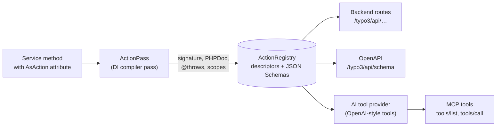

---

## From PHP method to HTTP endpoint

Every action is registered as a backend route below `/typo3/api/`. The
example above becomes:

```
GET /typo3/api/my-extension/page/42/titles
→ 200 ["Home", "Startseite", "Accueil"]
```

Each parameter is read from one place:

* **Route:** if the route contains a placeholder of the same name, like
  `{uid}`.
* **JSON body:** for `POST`, `PUT` and `PATCH` requests, which must be
  sent as `application/json`.
* **Query string:** otherwise. Objects and arrays are passed as
  JSON-encoded query parameters.

---

## Replacing internal AJAX routes

The first consumer of the Action API is the TYPO3 backend itself. Until
now, the backend JavaScript talks to the server via internal AJAX routes,
each with its own controller, argument parsing and error handling. Those
routes can be replaced by actions:

* the **dashboard** (dashboards, widgets, presets, categories),
* the **page tree** (tree data, filter, rootline, configuration),
* **resource** endpoints of the file list (rename, replace).

These migrations are part of the patch series. The former AJAX routes
were internal and are removed. As a side effect, everything the backend
can do through these actions is automatically available to external
applications and AI agents as well, with the same validation and
permission checks.

Backend JavaScript calls actions via the module
`@typo3/core/action/request`:

```javascript
import { action } from '@typo3/core/action/request.js';

const response = await action('/my-extension/page/{uid}/titles', { uid: '42' }).get();
const titles = await response.resolve();
```

Inside the backend, requests are authenticated by the session cookie
**plus** a bearer token that is embedded in the backend document and
bound to the logged-in user. The client adds the token automatically. A
session cookie alone is not sufficient, so other websites cannot trigger
actions in the name of a logged-in editor.

---

## How an HTTP request is dispatched

Requests below `/typo3/api/` take one of two ways through the backend
middleware stack:

* **With a backend session**, as the backend JavaScript sends them. The
  regular backend authentication applies. All scopes allowed for the user
  are granted.
* **Without a backend session**, from an external application. EXT:hub
  validates the app token, loads the backend user the token belongs to
  and hands the request directly to the action handler. Only the scopes
  of the token are granted.

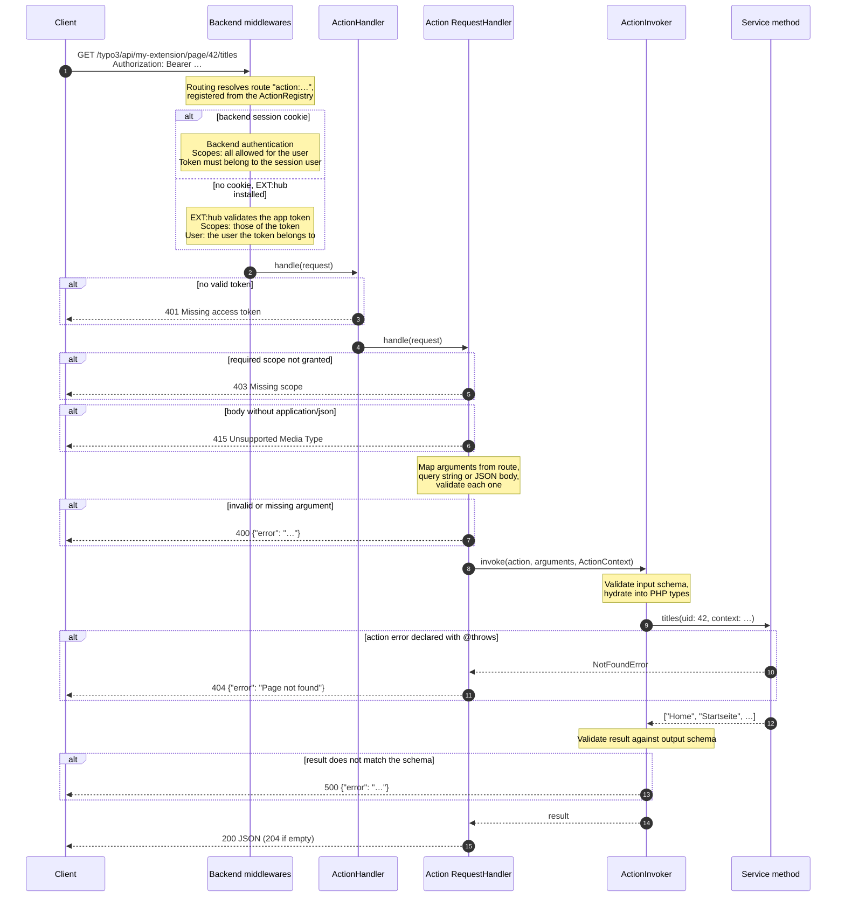

The `ActionInvoker` does not know about HTTP. The same invoker is used by
the MCP server and the AI tool provider, so validation, hydration and
error handling behave the same everywhere.

---

## External applications: EXT:hub

The new, optional system extension **EXT:hub** (`typo3/cms-hub`) opens the
Action API to external applications such as scripts, integrations, MCP
clients or AI agents, which have no backend session.

Administrators manage applications ("apps", table `sys_app`) in
**System › Integrations › API Hub**:

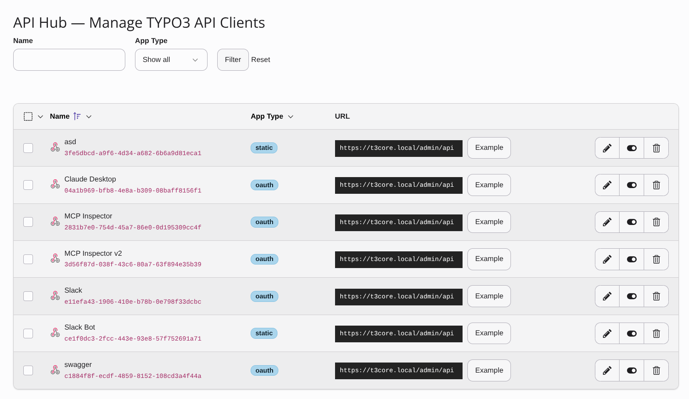

There are two types of apps:

* **Static token:** the app acts on behalf of a backend user selected in
  the app record and is granted the scopes selected there. An
  administrator generates the bearer token, which is valid until the app
  is disabled or its secret is changed. Typical use: server-to-server
  integrations and scripts.
* **OAuth:** the app uses the OAuth 2.0 authorization code flow including
  refresh tokens (based on `league/oauth2-server`). A backend user grants
  the app access on a consent screen, and the app then acts on behalf of
  that user. Typical use: MCP clients, AI agents and third-party tools.

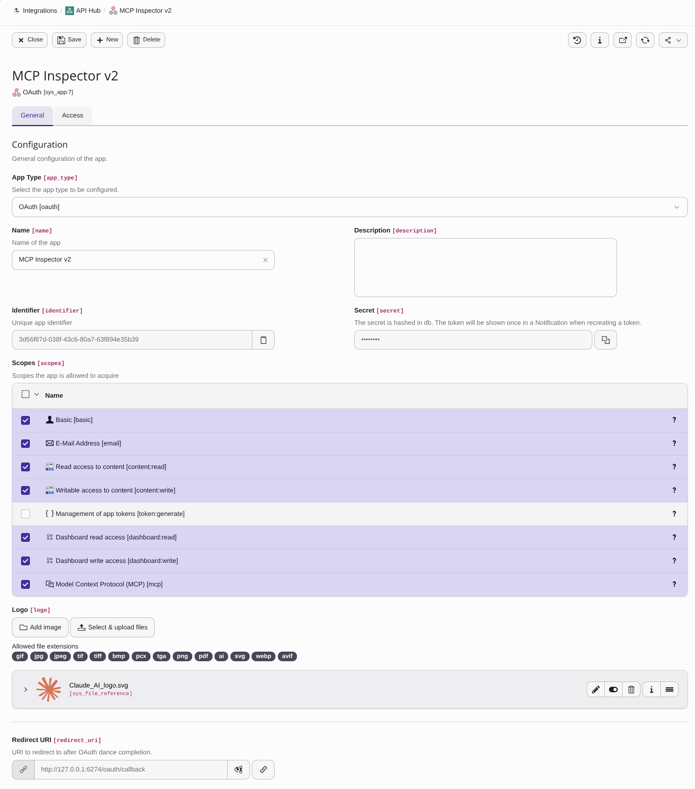

Clients discover the OAuth endpoints and the supported scopes via the
OAuth 2.0 Authorization Server Metadata
([RFC 8414](https://datatracker.ietf.org/doc/html/rfc8414)) at
`/.well-known/oauth-authorization-server`. The user grants access at
`/typo3/oauth/authorize`, and tokens are issued at `/typo3/oauth/token`.

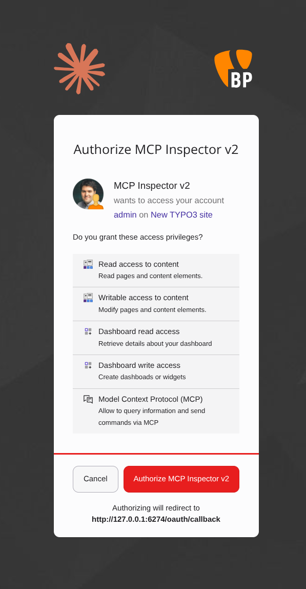

If the user is not logged in yet, the backend login is shown first. A new
option for backend routes, `redirect.standalone`, then sends the user
directly back to the consent screen, instead of embedding it in the
backend main view.

Requests without a backend session are authenticated with the token in
the `Authorization` header:

```bash
curl -H 'Authorization: Bearer <token>' \
    https://example.org/typo3/api/my-extension/page/42/titles
```

---

## Scopes: what an app may do

Scopes grant coarse access to groups of actions, for example
`content:read`, `content:write`, `dashboard:read` or `mcp`. A scope
implements `ScopeInterface` and is registered with its identifier:

```php
use Symfony\Component\DependencyInjection\Attribute\AsTaggedItem;
use TYPO3\CMS\Core\Scope\ScopeInterface;
use TYPO3\CMS\Core\Scope\ScopeUser;

#[AsTaggedItem(index: 'my-extension:news:read')]
final class NewsReadScope implements ScopeInterface
{
    public function getName(): string { return 'Read access to news'; }
    public function getDescription(): string { return 'Read news records.'; }
    public function getIcon(): string { return 'content-news'; }

    public function allowedForUser(ScopeUser $user): bool
    {
        return true;
    }
}
```

`allowedForUser()` decides whether a user may hold the scope at all. For
example, `dashboard:read` is only allowed for users with access to the
dashboard module, and `token:generate` only for administrators.

An action lists the scopes it requires. It is only executed if **all** of
them are granted; otherwise the response is `403`.

### Least privilege: app ∩ user

Scopes never extend what a user can do. They only **restrict** what an
app may do on behalf of the user. For an OAuth app, the granted scopes
are the intersection of:

1. the scopes the app requests,
2. the scopes configured for the app in its record,
3. the scopes allowed for the user who grants access.

On every request, the scopes of the token are intersected with the
scopes configured for the app again. A scope removed from the app record
therefore takes effect immediately, even for tokens already issued.

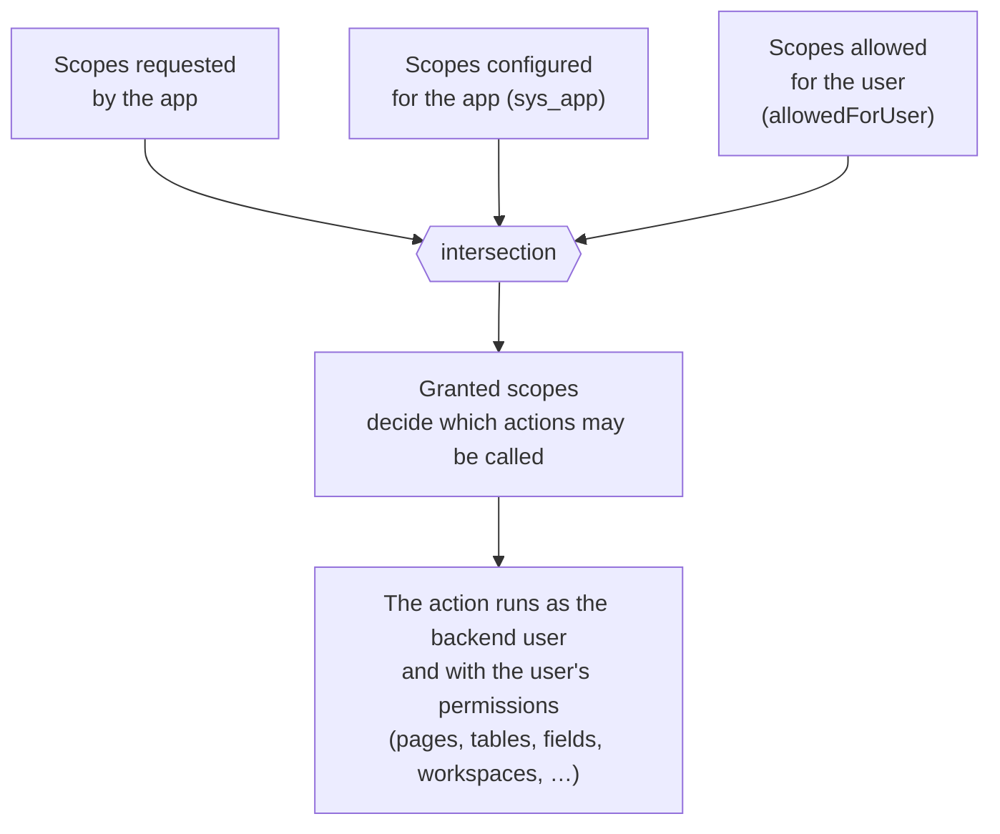

For a static token app, the administrator selects both the backend user
and the scopes in the app record.

Two layers protect every call:

1. **Scopes decide which actions an app may call at all.** An app with only
   `content:read` cannot call a write action, even if the user could.
2. **The user's permissions decide what the action may do.** The action
   runs as the backend user, so page permissions, table and field access,
   workspaces etc. apply as usual. An app with `content:write` cannot
   modify pages the user has no access to.

So an app is never more powerful than the user it acts for, and never
more powerful than the administrator configured it to be.

---

## Nesting: MCP is just another action

The [Model Context Protocol](https://modelcontextprotocol.io/) (MCP) is
the standard way for AI clients and agents to discover and call tools of
external systems.

TYPO3's MCP server is **not a separate endpoint**. It is an action itself,
`mcp`, of type `dispatch`, so it is exposed as `POST /typo3/api/mcp` and
requires the scope `mcp`. Routing, authentication via EXT:hub, scope
checks and validation apply to it exactly as to any other action. Inside,
it uses the same `ActionInvoker` to call the other actions as MCP tools.

The nesting, from the outside in:

1. **HTTP API:** the MCP client sends a JSON-RPC message to
   `POST /typo3/api/mcp`.
2. **EXT:hub:** the OAuth token identifies the backend user and the
   granted scopes.
3. **Action API:** the action `mcp` is invoked; it requires the scope
   `mcp`.
4. **MCP:** the JSON-RPC method is dispatched to `initialize`,
   `tools/list` or `tools/call`.
5. **Actions as tools:** every action whose scopes are granted is
   provided as a tool and invoked via the `ActionInvoker`.

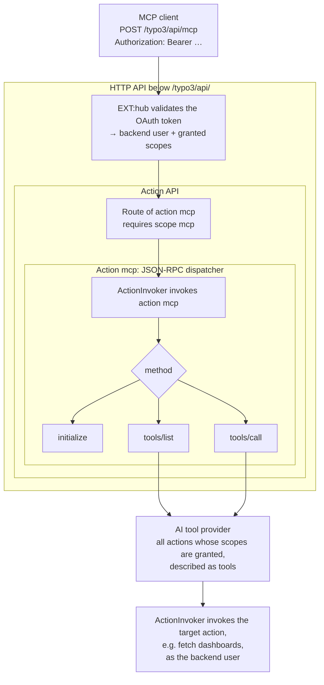

The same for a single tool call:

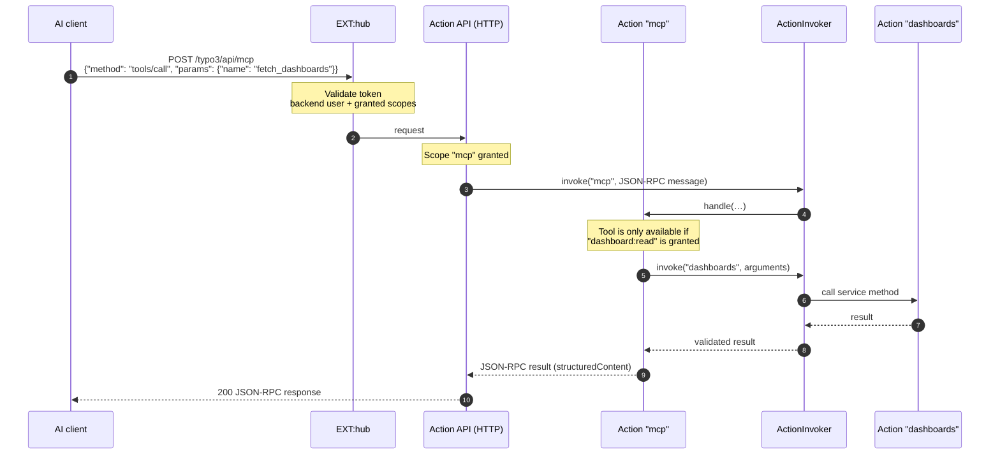

What MCP clients get from the action descriptions:

* **Tool list:** each action becomes a tool with title, description, input
  and output JSON Schema. Tool names are derived from type and name, for
  example `fetch_dashboards` or
  `fetch_dashboards_by_dashboardIdentifier_widgets_by_widgetIdentifier`.
  The `mcp` action itself is not offered as a tool.
* **Hints** are derived from the action type: `readOnlyHint` for `fetch`,
  `destructiveHint` for `delete` and `dispatch`, `idempotentHint` for
  `replace`. Clients use them, for example, to group read-only tools or to
  ask the user before a destructive call:

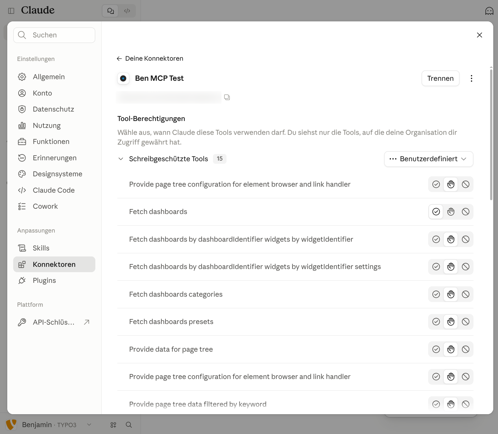

* **Errors** stay in the JSON-RPC format: invalid arguments are reported
  as "invalid params", action errors as tool results with `isError`.

Since the dashboard has been migrated to actions, an AI client can show
the user's dashboard, without any MCP-specific code in EXT:dashboard:

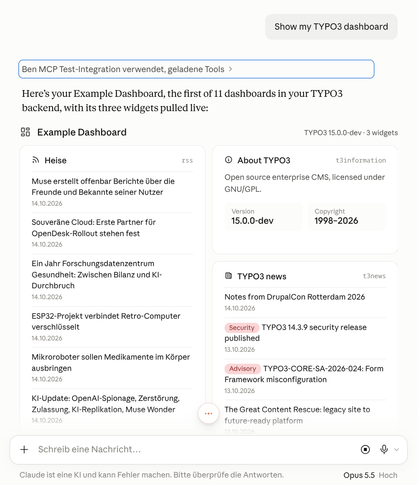

### Local usage via stdio

For MCP clients on the same machine, the CLI command `mcp:serve` serves
MCP over standard input and output, without EXT:hub. By default, it acts
as the CLI backend user `_cli_`. The option `--user` selects another
backend user, whose permissions and scopes then apply to all tool calls:

```json
{
    "mcpServers": {
        "typo3": {
            "command": "vendor/bin/typo3",
            "args": ["mcp:serve", "--user=editor"]
        }
    }
}
```

### AI tools for outgoing requests

The MCP tools are built by an internal AI tool provider, which describes
actions as OpenAI-style tool definitions. TYPO3 features that call an AI
service themselves can pass these tools along with their requests, with
the same validation and scope checks as MCP.

---

## OpenAPI and Swagger UI

From the same descriptions, an OpenAPI 3.1 document of all actions is
generated, including parameters, request and response schemas and the
declared errors. It is an action itself and available at
`GET /typo3/api/schema`.

The backend renders it with Swagger UI in two places:

* **System › Configuration** (button "API Documentation"), in every
  installation,
  because the Action API is part of the core and also serves the backend's
  own requests, while EXT:hub is optional.
* **API Hub module** ("API documentation"), next to the app management,
  when EXT:hub is installed.

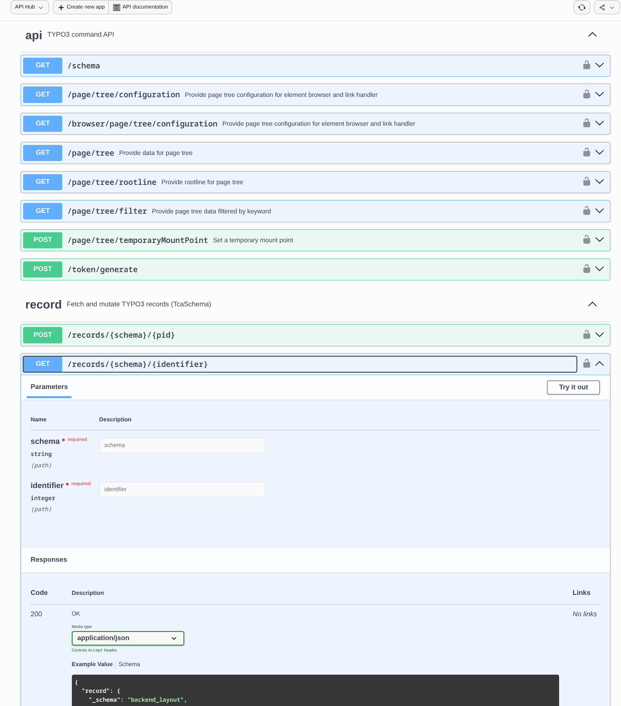

Because the schemas are real JSON Schema, complex data structures are
described precisely. The record actions, still work in progress, derive
the schema of each record type from TYPO3's `TcaSchema`. For example,
`tt_content` gets one variant per content type, with field types and
constraints:

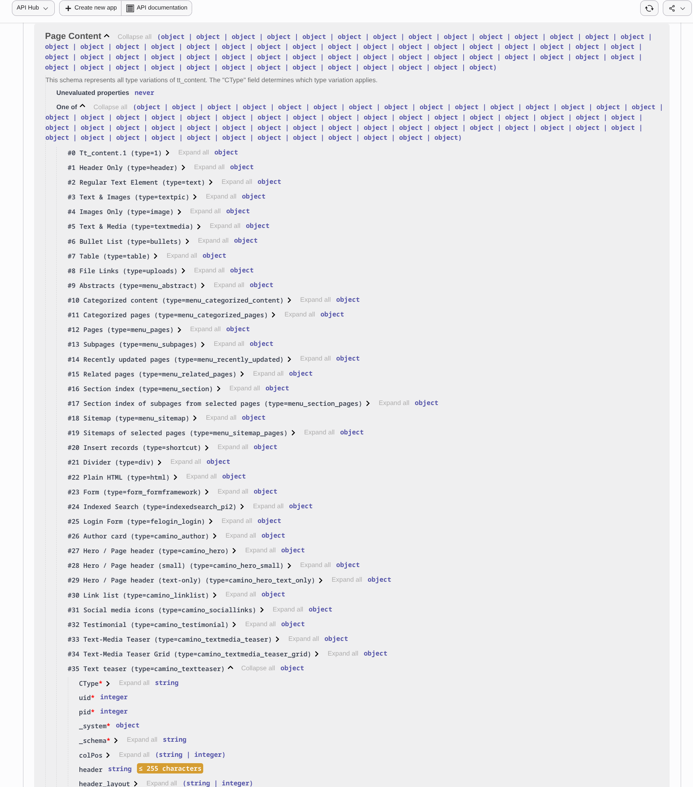

This makes the OpenAPI document usable for client code generation and
gives AI agents an exact description of the data they work with.

---

## Overview of the changes

| Issue                                            | Change                                                           |
|--------------------------------------------------|------------------------------------------------------------------|
| [#109428](https://forge.typo3.org/issues/109428) | JSON SchemaBuilder and schema based hydrator                     |
| [#111046](https://forge.typo3.org/issues/111046) | Action API: `#[AsAction]`, scopes, endpoints below `/typo3/api/` |
| [#111052](https://forge.typo3.org/issues/111052) | OpenAPI description and Swagger UI                               |
| [#111048](https://forge.typo3.org/issues/111048) | Standalone redirect option for backend routes (login → consent)  |
| [#111047](https://forge.typo3.org/issues/111047) | EXT:hub: API access for external apps (static token, OAuth 2.0)  |
| [#111049](https://forge.typo3.org/issues/111049) | AI tool provider based on actions                                |
| [#111050](https://forge.typo3.org/issues/111050) | MCP server based on actions (HTTP via EXT:hub, stdio via CLI)    |

All changes are grouped in the epic
[#111053](https://forge.typo3.org/issues/111053). Work in progress on
top: migration of the dashboard, page tree and resource endpoints from
AJAX routes to actions, and record actions based on `TcaSchema`.
